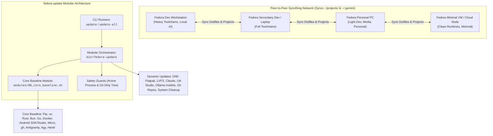

# AGENTS.md — Fedora Multi-Node Update & Maintenance Suite (`fedora-update`)

> **Repository:** [fedora-update](file:///home/jay/projects/update/fedora-update)  
> **Target OS:** Fedora Linux (Workstation, Development, VM, Personal)  
> **Sync Layer:** [Syncthing](https://syncthing.net/) (Syncs `~/.gemini` and `~/projects/`)  
> **Primary Executables:** [`update`](file:///home/jay/projects/update/fedora-update/update), [`update-all`](file:///home/jay/projects/update/fedora-update/update-all)

---

## 1. Executive Overview & System Architecture

### 1.1 Purpose & Mission
`fedora-update` is an automated, modular maintenance and toolchain synchronization system designed to keep a fleet of 3 to 5 heterogeneous Fedora computers (development workstations, personal machines, and lightweight virtual machines) completely updated, uniform, and in sync.

The environment utilizes **Syncthing** for continuous peer-to-peer synchronization of `~/.gemini` and `~/projects/`. The objective of `fedora-update` is to ensure that regardless of which physical or virtual Fedora machine the user logs into, all OS packages, development toolchains, AI agent environments, SDKs, CLI tools, documentation repositories, and system caches are fully synchronized, functional, and up to date with a **single 1-click command** (`update` or `update-all`).



---

## 2. Architecture & File Catalog

```
fedora-update/
├── update       # All logic lives here: ~970 lines, clearly sectioned
├── update-all   # 4-line wrapper: exec update --trim
├── install.sh   # First-time symlink + Syncthing bootstrap
├── AGENTS.md    # Agent operating manual
└── README.md    # User documentation & quickstart
```

Everything is in one file. To add a new tool: open `update`, find the right `### SECTION` block, add a step. No sourcing, no module loading order, no extra files.

---

## 3. Fleet Tiering: Core Fleet Baseline vs Installed-Only Tools

### 3.1 Core Fleet Baseline (`modules/00_core_baseline.sh`)
*Guaranteed to be installed and kept updated on every Fedora node (Dev, Personal, or Minimal VM):*

| Component | Install Method (if missing) | Upkeep & Active Guard |
| :--- | :--- | :--- |
| **Python 3 `pip`** | `sudo dnf install -y python3-pip` | `python3 -m pip install --user --upgrade pip` |
| **Astral `uv`** | `curl -LsSf https://astral.sh/uv/install.sh \| sh` | `uv self update` |
| **NPM Global Prefix** | Set prefix to `$HOME/.npm-global` | `npm update -g` |
| **Python CLI Suite** | `uv tool install <pkg>` (or `pip install --user`) | `uv tool upgrade --all` |
| **Micro Editor** | `sudo dnf install -y micro` | `micro -plugin update` |
| **GitHub CLI (`gh`)** | `sudo dnf install -y gh` | `gh extension upgrade --all` (if authed) |
| **Rust (`rustup`)** | `curl --proto '=https' --tlsv1.2 -sSf https://sh.rustup.rs \| sh` | `rustup update` |
| **Bun Runtime** | `curl -fsSL https://bun.sh/install \| bash` | `bun upgrade` |
| **Go & Tooling** | `sudo dnf install -y golang` $\rightarrow$ `gopls` & `dlv` | Module proxy query $\rightarrow$ `go install ...@latest` |
| **Docker Engine & Compose** | Docker CE repo $\rightarrow$ `docker-ce`, `docker-compose-plugin`, enable systemd | DNF updates + `docker image prune -f` |
| **Syncthing Sync Engine** | `sudo dnf install -y syncthing` $\rightarrow$ `0.0.0.0:8384` | User systemd service + DNF updates |
| **Android CLI & SDK** | Google Commandline Tools $\rightarrow$ `~/Android/Sdk` | `android update` |
| **Android Studio Preview** | Preview archive $\rightarrow$ `~/.local/opt/android-studio-preview` | Skip if running; update if idle |
| **Antigravity Desktop** | Cloud Run Manifest $\rightarrow$ `~/.local/opt/antigravity` | Skip if running; update if idle |
| **Antigravity IDE** | Cloud Run API $\rightarrow$ `~/.local/opt/antigravity-ide` | Skip if running; update if idle |
| **Agy CLI (`agy`)** | Official installer / npm $\rightarrow$ `~/.local/bin/agy` | Skip if active; `agy update` if idle |
| **Herdr CLI (`herdr`)** | `curl -fsSL https://herdr.dev/install.sh \| bash` | Skip if active; `herdr update` if idle |

---

### 3.2 Dynamic Installed-Only Updates
*Updated if present on the host; cleanly skipped without warnings if not:*
- **OS Packages:** `dnf upgrade --refresh -y`, `dnf autoremove -y`, `dnf clean packages`.
- **Flatpaks:** `flatpak update -y` (with `--no-static-deltas` fallback), `flatpak uninstall --unused -y`.
- **Firmware:** `fwupdmgr refresh` and `fwupdmgr get-updates`.
- **Secondary AI / LLMs:** Claude Code (`claude`), LM Studio (`lms`), Ollama binary + **only currently installed models**.
- **Dev Toolchains:** SDKMAN! (`sdk update`), Google Cloud SDK (`gcloud components update`), VS Code extensions (`code --update-extensions --force`), Agent skills (`skills update`).
- **Git Repositories:** `~/projects/docs/androidx`, `compose-samples`, `horologist`, `nowinandroid`, `~/.hermes/hermes-agent`.
- **System Cleanup:** Docker dangling image prune, journalctl vacuum (14d/500MB), optional SSD TRIM (`update-all`), and reboot necessity checks (`dnf needs-restarting -r`).

---

## 4. Key Agent Operating Rules & Safety Directives

All AI agents interacting with this repository MUST adhere to these strict engineering principles:

### Rule 1: Active Agent & App Protection (Zero Interruption)
- Before modifying or updating an AI agent, IDE, or editor (Antigravity IDE/Desktop, Agy, Claude, Herdr, Android Studio, VS Code), verify whether its process is actively working via `is_app_running`.
- If the process is active, **do not replace or restart the application binary**. Skip the update for that run with an explicit notice to protect the user's active session.

### Rule 2: Syncthing Non-Interference & Git Worktree Guard
- **Never modify Syncthing configuration, `.stignore`, or Syncthing service states.**
- Before running `git pull --rebase` inside synced projects (e.g. `~/projects/docs/`), check `git status --porcelain`. If any uncommitted edits or untracked conflicts exist, cleanly bypass the pull to prevent Syncthing conflict storms across nodes.

### Rule 3: Passwordless Sudo Resilience
- Use `lib/common.sh::ensure_passwordless_sudo` to ensure non-interactive execution works seamlessly on all nodes without stalling on sudo passwords.

---

## 5. Agent Standard Operating Procedures (SOPs)

### SOP 1: Auditing a Node Fleet Configuration
1. Run `./update --help` to verify the modular engine.
2. Run `./bin/fedora-update --only=core` to verify that all Core Baseline tools are present and functional.
3. Review `~/.local/state/update/last-update.log` for deterministic execution results.

### SOP 2: Adding a New Tool to the Suite
1. Determine if the tool is a **Core Baseline** item (required on all machines) or an **Installed-Only** item.
2. If Core Baseline: add bootstrap logic and update logic in [`modules/00_core_baseline.sh`](file:///home/jay/projects/update/fedora-update/modules/00_core_baseline.sh).
3. If Installed-Only: add existence check and update logic to the appropriate module in `modules/`.
4. Validate with `bash -n` across all scripts.

### SOP 3: Bootstrapping a Brand New Node
When provisioning a fresh Fedora machine, VM, or container before Syncthing is running:
1. Clone the repository to `~/projects/update/fedora-update`.
2. Run `~/projects/update/fedora-update/install.sh`.
   * This symlinks executables to `~/.local/bin/`, installs **Syncthing**, configures the Web UI at `0.0.0.0:8384`, and enables `syncthing.service`.
3. Execute `update` to trigger one-time passwordless sudo/Polkit setup and bootstrap all compilers, Docker, Android SDK, and AI agent toolchains.

---

## 6. Repository Metadata

- **Maintainer:** Jay & Agentic Fleet
- **Current Version:** 3.1.1 (Symlink Resolution & Self-Registration Fix)
- **Primary Branch:** `main`
- **Supported Architectures:** `x86_64`, `aarch64`

---

## 7. Changelog

### v2.1.0 (2026-08-24)

**Bug Fixes**
- `--skip=` now supports comma-separated values and repeated flags (`--skip=dnf,flatpak` or `--skip=dnf --skip=flatpak`).
- Fixed `local var="$(cmd)"` anti-pattern for `tmp_cmdline` in `00_core_baseline.sh` — declaration now separated from assignment to preserve mktemp exit code.
- `STEP_COUNT` increment changed from `((++))` to safe arithmetic form (`$((N + 1))`) in both `step()` and `skip_step()` in `lib/common.sh`.
- Ollama model updater now handles an empty model list without printing misleading `(0 detected)` output.
- Deduplicated `arch=$(uname -m)` detection in `run_core_baseline()` — was called twice (steps 14 and 15); now hoisted to function top.
- Normalized Antigravity Desktop ARM arch string from `linux-arm` → `linux-arm64` to match the IDE endpoint.

**New Features**
- `--dry-run` / `-n` flag: preview all steps without executing any system changes. `run_or_dry()` helper added to `lib/common.sh`; applied to DNF and Flatpak modules.
- `modules/08_self_update.sh` extracted from `06_git_docs.sh`; available independently as `--only=self`.
- `run_module()` helper in `bin/fedora-update` wraps every module with per-module elapsed time display.
- `notify-send` desktop completion notification fires at the end of each run in graphical sessions.
- High-visibility reboot-required banner (red box) replaces the previous low-contrast `[!]` warning in `07_cleanup.sh`.
- `tauri-cli` version check added before slow `cargo install --locked` to avoid unnecessary recompilation when already current.
- `install.sh` warns if `~/.local/bin` is not in `$PATH` after symlinking.

### v3.0.0 (2026-08-25)

**Architecture: Consolidated to Single-File**
- Removed `bin/`, `lib/`, and `modules/` directories entirely (13 files deleted).
- All logic consolidated into a single `update` script (~970 lines, clearly sectioned with `### SECTION:` headers).
- `update-all` is now a 4-line wrapper (`exec update --trim "$@"`).
- `install.sh` updated to only reference `update` and `update-all`.
- Result: `grep -n "tool_name" update` finds anything instantly. Adding a new tool is adding a block, not touching multiple files.

### v3.1.0 (2026-09-03)

**Performance & Concurrency Optimizations**
- **DNF Parallel Downloads & Single Pass:** Auto-configures `max_parallel_downloads=10` in `/etc/dnf/dnf.conf` across fleet nodes. Merged `makecache --refresh` into `dnf upgrade --refresh -y` in a single pass to eliminate redundant DNF process and repo loading overhead.
- **Fixed Ollama False Upgrade Loop:** Corrected release tag regex extraction from GitHub's single-line minified JSON (`tag_name`), fixing a bug where `lv` evaluated to `2026`, causing the Ollama engine installer to re-download on every run.
- **Parallel Git Documentation Sync:** Concurrent `git fetch` and dirty check across all documentation repositories (`androidx`, `compose-samples`, `horologist`, `nowinandroid`, `hermes-agent`) using isolated buffered subshells, reducing sync time from 20s+ to ~2s without log interleaving.
- **Fast-Path Global NPM Updates:** Added `npm outdated -g --json` pre-check (~700ms) before `npm update -g` (6s+) to skip full package tree writes when all global packages are current.
- **Claude Code Deduplication:** Skips redundant `claude update` network call if Claude is installed under `~/.npm-global` and was already verified in the NPM step.
- **UV Tool Caching & Force Flag:** Cached `uv tool list` before the missing tools loop and added `--force` to `uv tool install` so legacy pip wrappers are replaced and successfully registered with `uv`. Removed duplicate `uv cache prune` from Core Baseline.
- **Clean Needs-Restarting Output:** Passed `-q` to `sudo dnf needs-restarting` to eliminate repo loading chatter, and gracefully report when zero services require restarting.

### v3.1.1 (2026-09-07)

**Bug Fixes**
- **Canonical Script Directory Resolution:** Resolved `${BASH_SOURCE[0]}` using `readlink -f` across `update`, `update-all`, and `install.sh`. Previously, invoking `update` via a symlink in `~/.local/bin` resulted in `SCRIPT_DIR` evaluating to `~/.local/bin`.
- **Prevented Circular Symlink Creation:** Fixed self-registration logic in `update` line 1079 and `install.sh` that inadvertently overwrote `~/.local/bin/update` and `~/.local/bin/update-all` with circular symlinks pointing to themselves when invoked from PATH. Added guard against linking to `~/.local/bin` and adopted `ln -sfn`.
