# AGENTS.md — Fedora Multi-Node Update & Maintenance Suite (`fedora-update`)

> **Repository:** [fedora-update](file:///home/jay/projects/update/fedora-update)  
> **Target OS:** Fedora Linux (Workstation, Development, VM, Personal)  
> **Sync Layer:** [Syncthing](https://syncthing.net/) (Syncs `~/.gemini` and `~/projects/`)  
> **Primary Executables:** [`update`](file:///home/jay/projects/update/fedora-update/update), [`update-all`](file:///home/jay/projects/update/fedora-update/update-all)  
> **Automated Verification:** [`./test`](file:///home/jay/projects/update/fedora-update/test)

---

## 1. Executive Overview & System Architecture

### 1.1 Purpose & Mission
`fedora-update` is an automated, modular maintenance and toolchain synchronization system designed to keep a fleet of 3 to 5 heterogeneous Fedora computers (development workstations, personal machines, and lightweight virtual machines) completely updated, uniform, and in sync.

The environment utilizes **Syncthing** for continuous peer-to-peer synchronization of `~/.gemini` and `~/projects/`. The objective of `fedora-update` is to ensure that regardless of which physical or virtual Fedora machine the user logs into, all OS packages, development toolchains, AI agent environments, SDKs, CLI tools, documentation repositories, and system caches are fully synchronized, functional, and up to date with a **single 1-click command** (`update` or `update-all`).

```mermaid
graph TD
    subgraph Syncthing_Cluster["Peer-to-Peer Syncthing Network (Syncs ~/projects/ & ~/.gemini)"]
        Dev1["Fedora Dev Workstation<br/>(Heavy Toolchains, Local AI)"]
        Dev2["Fedora Secondary Dev / Laptop<br/>(Full Toolchains)"]
        Pers1["Fedora Personal PC<br/>(Light Dev, Media, Personal)"]
        VM1["Fedora Minimal VM / Cloud Node<br/>(Clean Runtimes, Minimal)"]
    end

    subgraph Fedora_Update_Suite["fedora-update Recipe-Based Architecture"]
        Runner["CLI Runners:<br/><code>update</code> / <code>update-all</code>"]
        Engine["Core Orchestrator:<br/>Argument parsing, logging, process mgmt, dynamic discovery"]
        Recipes["Isolated Recipes (<code>recipes.d/*/*.sh</code>):<br/>Fault-isolated, zero blast radius"]
        Helpers["Polyglot Helpers (<code>helpers/*.py</code>):<br/>Android Canary scraper, Electron asar extractor"]
        Gate["Verification Gate (<code>./test</code>):<br/>Syntax & dry-run test harness"]
    end

    Dev1 <-->|Sync Dotfiles & Projects| Dev2
    Dev2 <-->|Sync Dotfiles & Projects| Pers1
    Pers1 <-->|Sync Dotfiles & Projects| VM1

    Runner --> Engine
    Engine --> Recipes
    Recipes --> Helpers
    Gate -.-> Engine
```



---

## 2. Architecture & File Catalog

```
fedora-update/
├── update                 # Core runner & lifecycle engine (~380 lines)
├── update-all             # 4-line wrapper: exec update --trim "$@"
├── install.sh             # Bootstrap symlinks, permissions & Syncthing
├── test                   # Automated verification gate (bash -n, py_compile, dry-run)
├── helpers/               # Standalone polyglot scripts
│   ├── android_canary.py  # Android Studio Canary metadata resolver
│   └── asar_icon.py       # Electron asar icon extractor
├── recipes.d/             # Isolated tool recipes by category
│   ├── core/              # Baseline fleet tools (22 recipes)
│   ├── dnf/               # DNF upgrades & cleanups (3 recipes)
│   ├── flatpak/           # Flatpak applications & runtimes (2 recipes)
│   ├── snap/              # Snap packages & runtimes (1 recipe)
│   ├── firmware/          # Hardware firmware checks (1 recipe)
│   ├── ai/                # AI agents & LLM runtimes (5 recipes)
│   ├── dev/               # Developer SDKs & extensions (5 recipes)
│   ├── git/               # Parallel git documentation sync (1 recipe)
│   ├── self/              # Self-update logic (1 recipe)
│   └── cleanup/           # Docker, Podman, caches & journal vacuum (6 recipes)
├── AGENTS.md              # Agent operating manual
└── README.md              # User documentation & quickstart
```

### Why This Recipe Architecture is Optimized for AI Agents:
1. **Zero Blast Radius:** Every tool has its own small file in `recipes.d/`. An LLM asked to modify or add a tool only loads and edits that single recipe (~30 lines, ~300 tokens).
2. **Runtime Fault Tolerance:** `update` tests every recipe with `bash -n` before sourcing. If an LLM creates a syntax error in one recipe, it will log the error and safely proceed with all other system updates.
3. **Dynamic Step Accounting:** `TOTAL_STEPS` is counted dynamically at launch by inspecting `recipes.d/`. No manual arithmetic bookkeeping is required when adding or removing tools.
4. **Generic Lifecycle Engine (`sync_tar_app`):** Replaces ~400 lines of duplicated GUI/IDE shutdown, download, and restart logic across Android Studio, Antigravity Desktop, Antigravity IDE, and VS Code.

---

## 3. Fleet Tiering: Core Fleet Baseline vs Installed-Only Tools

### 3.1 Core Fleet Baseline (`recipes.d/core/`)
*Guaranteed to be installed and kept updated on every Fedora node (Dev, Personal, or Minimal VM):*

| Component | Recipe File | Install / Update Method |
| :--- | :--- | :--- |
| **C/C++ Build Tools & Downloaders** | `01-c-build-tools.sh` | `gcc, gcc-c++, make, pkgconf-pkg-config, aria2, zstd` via DNF |
| **Python 3 & pip** | `02-python-pip.sh` | `python3-pip` via DNF $\rightarrow$ `python3 -m pip install --upgrade pip` |
| **Astral uv** | `03-astral-uv.sh` | Astral installer $\rightarrow$ `uv self update` |
| **Node.js LTS** | `04-node-lts.sh` | `nvm install --lts` (or DNF fallback `nodejs npm`) |
| **NPM Global Prefix** | `05-npm-global.sh` | Prefix set to `$HOME/.npm-global` $\rightarrow$ `npm update -g` |
| **Python CLI Suite** | `06-python-cli-suite.sh` | `uv tool install --force` $\rightarrow$ `uv tool upgrade --all` |
| **Micro Editor** | `07-micro-editor.sh` | DNF / binary $\rightarrow$ `micro -plugin update` |
| **GitHub CLI (gh)** | `08-github-cli.sh` | DNF $\rightarrow$ `gh extension upgrade --all` |
| **Rust (rustup)** | `09-rust-toolchain.sh` | `rustup update` + `cargo-tauri` version-check & build |
| **Bun Runtime** | `10-bun-runtime.sh` | Bun installer $\rightarrow$ `bun upgrade` |
| **Go & Tooling** | `11-golang-tooling.sh` | `golang` $\rightarrow$ `gopls`, `dlv`, & `goplay` via proxy check (`GOTOOLCHAIN=auto`) |
| **Docker Engine & Compose** | `12-docker-engine.sh` | Docker CE repo $\rightarrow$ systemd service active |
| **Android CLI & SDK** | `13-android-sdk.sh` | Google commandlinetools $\rightarrow$ `android update` |
| **Android Studio Preview** | `14-android-studio-canary.sh` | Google Canary XML & CDN $\rightarrow$ `sync_tar_app` |
| **Antigravity Desktop** | `15-antigravity-desktop.sh` | Cloud Run Manifest $\rightarrow$ `sync_tar_app` |
| **Antigravity IDE** | `16-antigravity-ide.sh` | Cloud Run API $\rightarrow$ `sync_tar_app` |
| **Agy CLI** | `17-agy-cli.sh` | `npm install -g @google/agy` $\rightarrow$ `agy update` |
| **Herdr CLI** | `18-herdr-cli.sh` | Herdr installer $\rightarrow$ `herdr update --handoff` |
| **Syncthing** | `19-syncthing.sh` | DNF + systemd user service + GUI on `0.0.0.0:8384` |
| **AppImage Manager** | `20-app-manager.sh` | `app-manager --update-all` |
| **RustDesk** | `21-rustdesk.sh` | GitHub Releases RPM (`rustdesk/rustdesk`) $\rightarrow$ `dnf install` |
| **OpenLogi** | `22-openlogi.sh` | GitHub Releases RPM (`AprilNEA/OpenLogi`) $\rightarrow$ `dnf install` |

---

### 3.2 Dynamic Installed-Only Updates
*Updated if present on the host; cleanly skipped without warnings if not:*
- **OS Packages (`recipes.d/dnf/`):** `01-upgrade.sh` (parallel DNF single pass), `02-autoremove.sh`, `03-clean.sh`.
- **Flatpaks (`recipes.d/flatpak/`):** `01-prune-unused.sh` (pre-update cleanup), `02-update.sh` (with downgrade rollback masking).
- **Snap Packages (`recipes.d/snap/`):** `01-snap-refresh.sh` (`snap refresh`).
- **Firmware (`recipes.d/firmware/`):** `01-firmware.sh` (`fwupdmgr refresh` and `fwupdmgr get-updates`).
- **AI Runtimes (`recipes.d/ai/`):** `01-claude-code.sh`, `02-lm-studio.sh`, `03-ollama-models.sh` (Ollama binary + concurrent model pulls), `04-nvbroadcast.sh` (NV Broadcast RPM from GitHub releases), `05-claude-desktop.sh` (Claude Desktop official Linux `.deb` repackaged to RPM via `claude-desktop-fedora/build-official.sh`).
- **Dev Toolchains (`recipes.d/dev/`):** `01-sdkman.sh` (`sdk upgrade`), `02-gcloud-sdk.sh`, `03-vscode-extensions.sh`, `04-agent-skills.sh`, `05-distrobox.sh` (`distrobox-upgrade --all`).
- **Git Repositories (`recipes.d/git/`):** `01-git-docs.sh` (parallel sync of `androidx`, `compose-samples`, `horologist`, `nowinandroid`, `unraid`, `audiobookshelf-api-docs`, `hermes-agent`, `claude-desktop-fedora`).
- **Self-Update (`recipes.d/self/`):** `01-self-update.sh` (git pull with dirty tree check).
- **System Cleanup (`recipes.d/cleanup/`):** `01-docker-prune.sh`, `02-caches.sh`, `03-journal-vacuum.sh`, `04-ssd-trim.sh`, `05-podman-prune.sh`, `06-reboot-check.sh`.

---

## 4. Key Agent Operating Rules & Safety Directives

### Rule 1: Active Agent & App Protection (Zero Interruption by Default; Safe Restart with `--force`)
- Before modifying or updating an AI agent, IDE, or editor (Antigravity IDE/Desktop, Agy, Claude, Herdr, Android Studio, VS Code), verify whether its process is active via `is_*_running`.
- **Default (Zero Interruption):** If the process is active, skip the update to protect the user's active session.
- **Force Mode (`--force` / `-f`):** When `--force` is specified, `fedora-update` checks if an update is available first. If an update is required, it gracefully terminates the application (SIGTERM with clean shutdown wait and SIGKILL fallback), applies the update, and automatically relaunches the application (`gtk-launch` or background daemon).
- **Targeted App Force-Update (`--app` / `-a [APP]` and `--force=APPS`):**
  - `update --app` (or `update -a`) launches an interactive terminal selector (`fzf` multi-select with numbered fallback) showing live `[RUNNING]` / `[idle]` badges at the top of the list, then force-updates only the chosen recipe(s).
  - `update --app <name>` (e.g. `update -a rustdesk`) immediately force-updates only the specified recipe(s) without touching other running apps.
  - `update --force=<name>` runs the full suite while only force-restarting the specified app(s).
- **Ancestor Protection:** The script verifies whether any running target process is an ancestor of the running shell (`$$`). If spawned inside an IDE terminal, shutdown is bypassed to prevent killing its own parent session.

### Rule 2: Syncthing Non-Interference & Git Worktree Guard
- **Never modify Syncthing configuration, `.stignore`, or Syncthing service states.**
- Before running `git pull --rebase` inside synced projects, check `git status --porcelain`. If any uncommitted edits exist, cleanly bypass the pull.

### Rule 3: Verification Gate Mandatory Before Declaring Victory
- **Always run `./test`** after modifying any code or recipe in this repository. Ensure all syntax checks and dry-run tests pass deterministically.

---

## 5. Agent Standard Operating Procedures (SOPs)

### SOP 1: Adding a New Tool to the Suite
1. Choose the appropriate category in `recipes.d/` (e.g. `core/`, `dev/`, `ai/`).
2. Create a new `.sh` recipe file (e.g. `recipes.d/core/20-deno.sh`).
3. Call `step "Core: Tool Name"` and write the check/install/update logic.
4. Execute `./test` to verify syntax and dry-run simulation.
5. `TOTAL_STEPS` and module filtering auto-detect the new file with zero manual bookkeeping.

### SOP 2: Modifying an Existing Tool
1. Locate the recipe: `recipes.d/<category>/<tool>.sh`.
2. Inspect and modify only that file (~30 lines).
3. Run `./test` to confirm bash syntax and dry-run execution.

### SOP 3: Provisioning a Fresh Node
When provisioning a fresh Fedora machine before Syncthing is running:
1. Clone the repository to `~/projects/update/fedora-update`.
2. Run `bash install.sh`.
   * Symlinks `update` and `update-all` into `~/.local/bin/`.
   * Sets permissions on scripts, helpers, and recipes.
   * Bootstraps **Syncthing** and configures the Web UI at `0.0.0.0:8384`.
3. Execute `update` to trigger one-time passwordless sudo setup and bootstrap all toolchains.

---

## 6. Repository Metadata

- **Maintainer:** Jay & Agentic Fleet
- **Current Version:** 4.1.0 (Concurrent Wave Orchestrator, RPM Mutex & Claude Desktop Official RPM)
- **Primary Branch:** `main`
- **Supported Architectures:** `x86_64`, `aarch64`

---

## 7. Changelog

### v4.1.0 (2026-10-22)

**Architecture: Concurrent Wave Orchestrator & Claude Desktop Official RPM**
- **Two-Tier Concurrency (`_run_parallel_recipe_batch` & `run_parallel_modules`):**
  - **Intra-Module Concurrency:** Within `core` (after sequential bootstrap of `gcc`, `pip`, `uv`, `node`, `npm`), all 17 independent toolchains/apps run concurrently. All recipes within `ai`, `dev`, and `cleanup` (prior to `06-reboot-check.sh`), plus `gopls`/`dlv`/`goplay` and `ollama pull` workers, execute in parallel.
  - **Inter-Module Wave Concurrency:** Overlaps `dnf` + `flatpak` + `snap` + `firmware` in Wave 1, and `ai` + `dev` + `git` + `self` in Wave 2, while preserving deterministic step numbering (`[1/46]`..`[46/46]`) and ordered terminal/log output.
- **RPM Database Mutex (`with_rpm_lock`):** Serializes all `sudo dnf` and `sudo rpm` calls via `flock` so concurrent recipes can check APIs, download packages, and build RPMs in parallel without colliding on `/var/lib/rpm/.rpm.lock`.
- **Claude Desktop Official Linux RPM (`recipes.d/ai/05-claude-desktop.sh`):** Verifies Anthropic's GPG-signed apt index via `~/projects/claude-desktop-fedora/build-official.sh`, respects running session protection (`--force` / `update --app claude-desktop`), and repackages/installs new releases automatically.

### v4.0.0 (2026-09-29)

**Architecture: LLM-Optimized Modular Recipe Architecture & AI Verification Gate**
- **Contract-Based Recipes (`recipes.d/`):** Decomposed the 1,662-line monolithic script into 39 small, isolated recipe files categorized under `core/`, `dnf/`, `flatpak/`, `firmware/`, `ai/`, `dev/`, `git/`, `self/`, and `cleanup/`.
- **Fault-Isolated Runner:** Orchestrator (`update`, ~380 lines) validates each recipe with `bash -n` at runtime before sourcing, ensuring that a syntax typo in one recipe cannot crash the fleet updater.
- **Dynamic Step Accounting:** Replaced hardcoded step arithmetic (`TOTAL_STEPS=$((TOTAL_STEPS + 19))`) with dynamic recipe discovery matching `--only` and `--skip` flags.
- **Generic Application Lifecycle Engine (`sync_tar_app`):** Unified download, extraction, version management, `--force` graceful shutdown (SIGTERM $\rightarrow$ SIGKILL), launcher generation, and background restart across Android Studio, Antigravity Desktop, Antigravity IDE, and VS Code.
- **Polyglot Helper Extraction (`helpers/`):** Extracted 72 lines of embedded Python Canary XML/HTML scraping into `helpers/android_canary.py` and Electron asar unpacking into `helpers/asar_icon.py`.
- **Dual-Channel Observability (`run_silent_log`):** Redirects stderr to `$LOG_FILE` while keeping interactive terminal output clean, eliminating silent error swallowing (`2>/dev/null || true`).
- **AI Verification Gate (`./test`):** 1-second automated verification script checking `bash -n` across all entry points and recipes, `python3 -m py_compile` across helpers, and simulated `--dry-run` execution.

### v3.1.4 (2026-09-29)
- Force Mode (`--force` / `-f`) and graceful application shutdown/restart.
